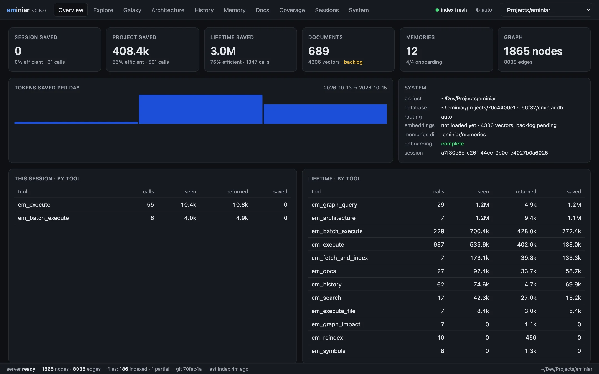
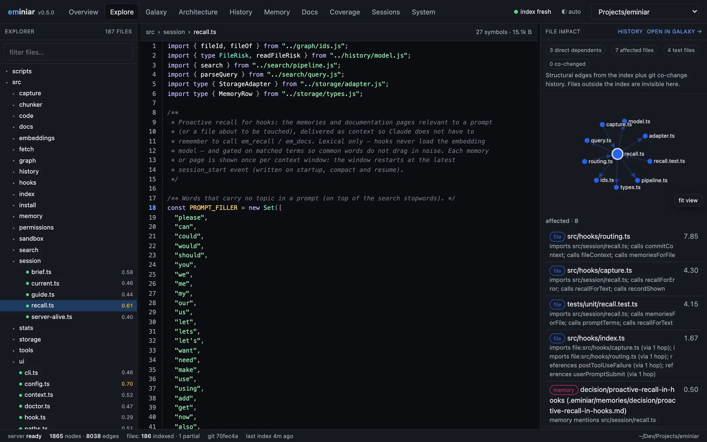
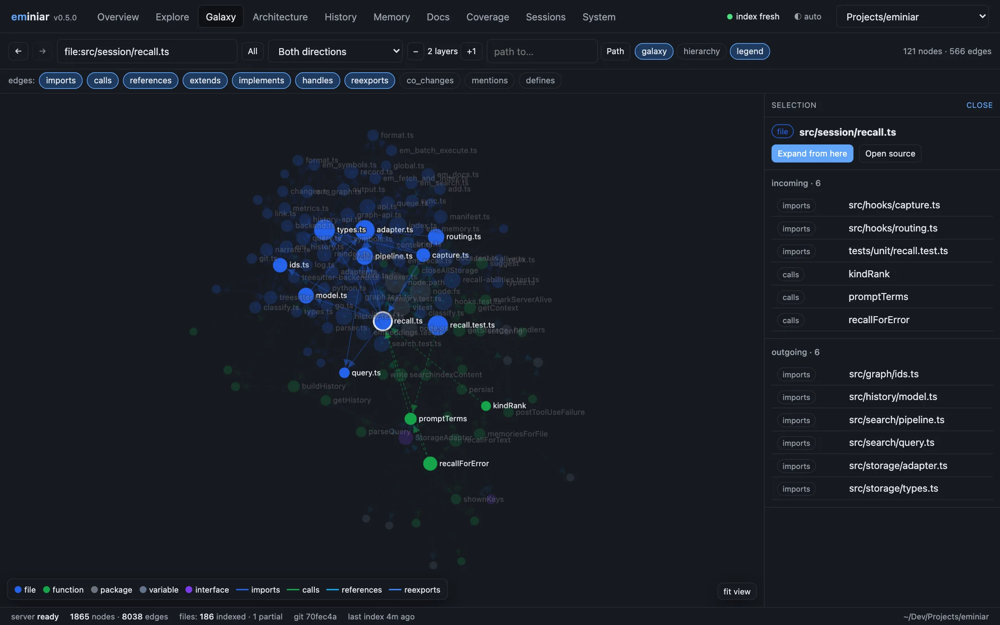
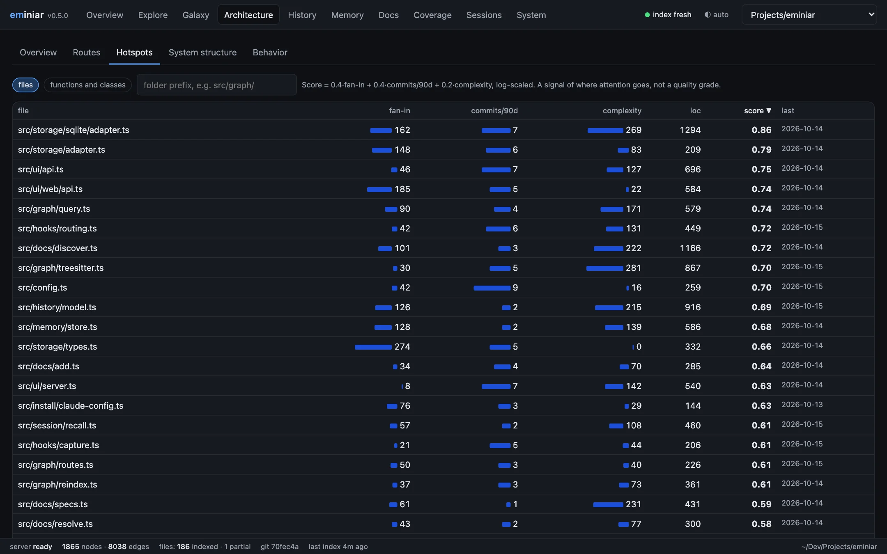
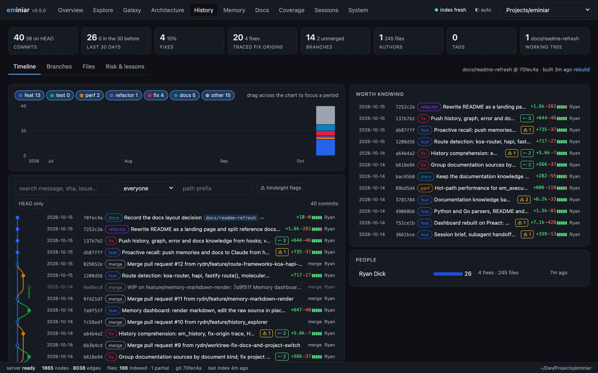
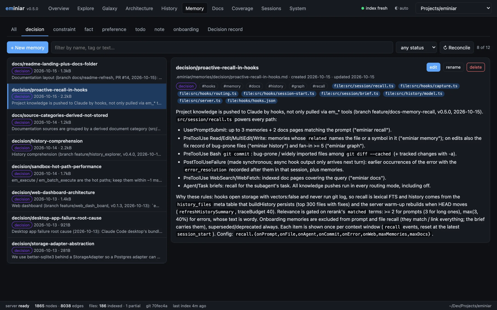
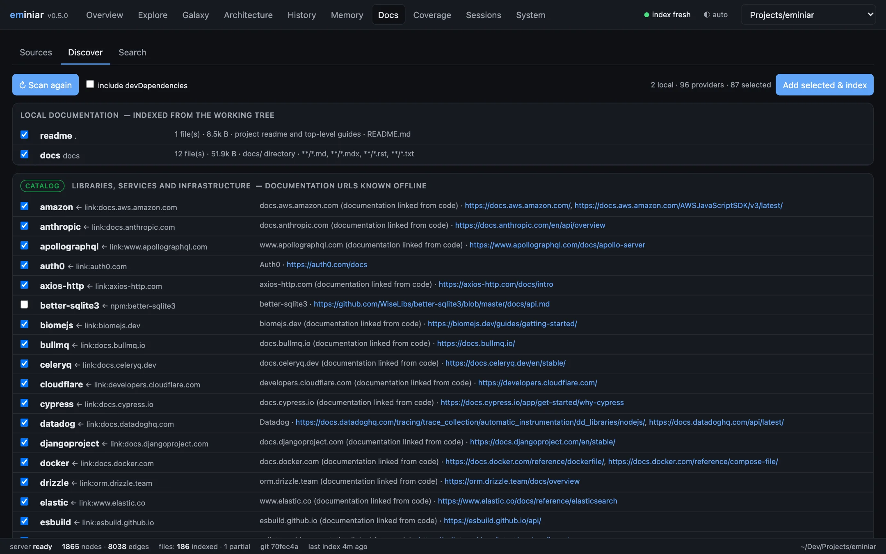
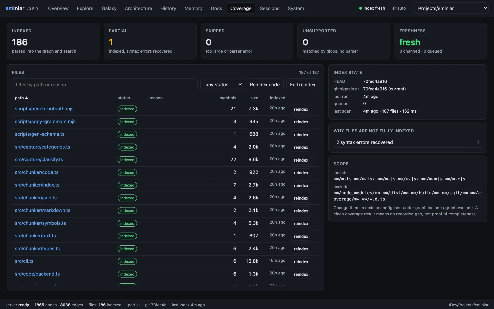

# Dashboard

[← Docs index](README.md)

```sh
eminiar ui                  # opens http://127.0.0.1:7331
eminiar ui --port 8080 --no-open
```

The dashboard is a local web app for the current project. It is one self-contained page (Preact,
d3-force, Prism) with no CDN. The theme follows your system, or you can choose light or dark.

## Tabs

### Overview



Token savings per session, per project and over your lifetime. Index and graph sizes.

### Explore



A source explorer for the project.

- **File tree** with index status and heat.
- **Source view** with syntax highlighting and a symbol gutter.
- **File impact:** dependents, affected files, tests, co-changed files and linked memories.
- **Code details** for the symbol under the cursor: callers, calls, references and metrics.

### Galaxy



The knowledge graph on a canvas. Search for a node, choose the direction and edge kinds, expand
one layer at a time, find a path between two nodes, or switch to a folder hierarchy. Back and
forward buttons step through your exploration.

### Architecture



- Folder treemap, sized by code size or coloured by heat.
- Routes with their handlers.
- Hotspot table (shown above).
- Clusters with their import cycles.
- A behaviour tree of the calls that an operation can make.

### History



The interactive version of [`em_history`](knowledge-graph.md#git-history).

- Weekly activity by commit kind, with a brush to select a time range.
- The commit graph (DAG) with branch lanes.
- A scatter plot of churn against fix share, to find fragile files.
- The story of one file.
- Branch comparison.
- The lessons the history teaches: changes that later needed fixing.

### Memory



Browse and edit `.eminiar/memories`. Shows decision status and `supersedes` links, and compiles
a decision record.

### Docs



Documentation sources with their pages and sync state. Add a source by URL, path or provider. A
discovery screen lists local docs, catalogue providers, APIs found in code, registry packages
and unknown hosts (with a field for a URL). It also has a docs-only search.

### Coverage



Files that are indexed, partly indexed, skipped or unsupported, each with the reason. Freshness
against `HEAD` and the working tree. Reindex one file.

### Sessions and System

Session event timelines, maintenance actions, doctor checks and the index-run log.

## Deep links

Views have hash routes, so you can bookmark or share a link to a view:

```text
http://127.0.0.1:7331/#/explore?file=src/server.ts
```

## Security

- The server answers loopback hosts only (`127.0.0.1`, `localhost`, `[::1]`).
- Every request that writes needs a JSON content type and a loopback `Origin`.
- File reads are checked to stay inside the project root.

`eminiar serve` is an older name for the same command.
