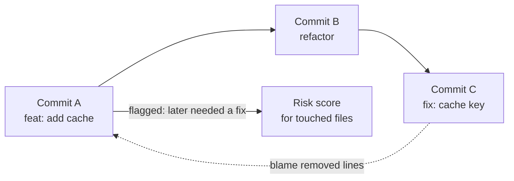

# Knowledge graph and history

[← Docs index](README.md)

eminiar builds a **knowledge graph** of your project. Claude uses it to answer structural
questions without reading whole files:

- *Where is `parseFile` defined, and who calls it?*
- *What breaks if I change `src/auth.ts`?*
- *Which routes exist, and which functions handle them?*
- *Which files are fragile?*

## What is in the graph

The graph is built with tree-sitter. No language servers are needed.

**Languages:** TypeScript, JavaScript (`.ts .tsx .js .jsx .mjs .cjs`), Python and Go.

**Node kinds:**

| Kind | Examples |
|---|---|
| Code | `file`, `function`, `class`, `method`, `interface`, `type` |
| Web | `route` (for example `route:GET /users/:id`) |
| Project | `package`, `person` (git authors), `concept` (curated), `memory` |

**Main edge kinds:** `imports`, `reexports`, `exports`, `defines`, `calls`, `references`,
`extends`, `implements`, `handles` (handler → route), `co_changes` (git coupling), `mentions`
(memory → code), `authored` (person → file).

### Link pass

After parsing, a link pass resolves edges across files. It follows barrel files and re-exports,
default exports, Go packages and inherited methods. A call to `user.save()` therefore reaches the
`save` method of the right class, even through an `index.ts` barrel.

### HTTP routes

Routes become graph nodes, so impact analysis from a handler reaches its endpoint.

| Style | Frameworks |
|---|---|
| Call-based (`app.get("/p", h)`) | Express, Fastify, koa-router (with `prefix` and named routes), Hono, Restify and similar |
| Config object (`server.route({ method, path, handler })`) | hapi, Fastify `route()` |
| Schema-declared | Moleculer (`moleculer-web` aliases and `rest` shorthands) |
| File-based | Next.js `app/**/route.ts` and `pages/api/**` |
| Decorators | Python route decorators |
| Router calls | Go: `http.HandleFunc`, `mux.Handle`, `r.GET` style routers |

### Metrics

Each node gets:

| Metric | Meaning |
|---|---|
| **Fan-in** | How many nodes depend on it |
| **Complexity** | Code complexity. A file adds up the complexity of its symbols |
| **Churn** | How many commits changed it in the last 90 days |
| **Hotspot score** | 40% fan-in + 40% churn + 20% complexity, each normalised on a log scale |

A high hotspot score marks a place worth a careful look. It is not a quality grade.

The graph also has **module clusters**, **import cycles** and **co-change coupling** (files that
change together in git, even without an import between them).

## Ask the graph

### The project map

```text
em_architecture {}
em_architecture {aspects: ["routes", "hotspots"]}
```

One screen: languages and coverage, folders with size and heat, entry points, routes,
hotspots, clusters, cycles and accepted decisions. Use it at the start of a task.

### Symbols

`em_symbols` navigates code by name, like Serena, but without language servers.

```text
em_symbols {mode: "overview", file: "src/server.ts"}           # outline of a file
em_symbols {mode: "find", name_path: "Server/start", include_body: true}
em_symbols {mode: "find", name_path: "src/x.ts#Class.method"}
em_symbols {mode: "references", name_path: "parseFile"}
```

### Impact

```text
em_graph_impact {node: "file:src/auth.ts"}
em_graph_impact {node: "src/parse.ts#parseFile", mode: "dependents", depth: 2}
em_graph_impact {node: "src/a.ts", mode: "path", to: "src/b.ts"}
```

The answer lists dependents, affected files, tests, co-changed files and the **memories to read
before the change**, with the reason for each.

### What a diff touches

```text
em_graph_changes {}            # working tree
em_graph_changes {ref: "main"} # against a ref
```

It lists the symbols that the diff changes, how exposed they are, and the files the change can
reach.

### Presets and patterns

```text
em_graph_query {preset: "hotspots"}
em_graph_query {preset: "dead_code"}
```

A **pattern** walks typed edges from a start filter to an end filter:

```text
# every route handler
em_graph_query {pattern: {from: {kind: "route"}, edge: {kinds: ["handles"], direction: "in"}}}

# callers of parseFile, two levels up
em_graph_query {pattern: {from: {name: "^parseFile$"}, edge: {kinds: ["calls"], direction: "in", depth: 2}}}
```

### Freshness

`em_index_status` shows whether the graph matches `HEAD` and the working tree, and which files
were skipped or only partly parsed, with the reason. When Claude reads a partly indexed file, a
hook says so, so Claude does not trust a missing caller too much.

## Git history

`em_history` reads the git history **for** Claude, so Claude does not read raw `git log`.



1. **Classify.** Every commit on every branch gets a kind: `feat`, `fix`, `refactor`, `perf`,
   `test`, `docs` and others.
2. **Trace fixes.** For each fix, eminiar blames the lines it removed. This finds the commit that
   wrote the broken code. That commit is flagged as *later needed fixing*.
3. **Score files.** Each file gets a history-risk score with reasons: share of fix commits,
   changes that later needed fixing, recent fixes.
4. **Compare branches.** Branches get ahead/behind counts and merge state against the base.

Commit messages are also indexed for `em_search` (source `git`).

### When Claude sees it

You do not have to ask. Before Claude edits a bug-prone file, a hook adds a note:

```text
eminiar history: src/cli.ts is bug-prone (1/6 commits were fixes; 1 earlier change later needed
fixing; last fix 3f8c697 Fix MCP registration, make enforce routing and dev upgrades safe).
```

Before a `git commit`, a hook lists the bug-prone and widely imported files in the commit.

### Ask it directly

```text
em_history {action: "file", path: "src/auth.ts"}   # before an edit
em_history {action: "risk"}                        # before a commit
em_history {action: "branch", name: "feature/x"}
em_history {action: "symbol", name_path: "parseFile"}
em_history {action: "search", query: "token refresh"}
```

The dashboard **History** tab is the interactive version. See [Dashboard](dashboard.md#history).

## Curate the graph

`em_graph_add` adds your own `concept` nodes and edges, for example a business concept and the
files that implement it. Memories join the graph automatically.

## Configure

```json
{
  "graph": {
    "include": ["**/*.ts", "**/*.py", "**/*.go"],
    "exclude": ["**/node_modules/**", "**/dist/**", "**/vendor/**"]
  },
  "git": { "maxCommits": 3000 }
}
```

See [Configuration](configuration.md) for the full defaults.
